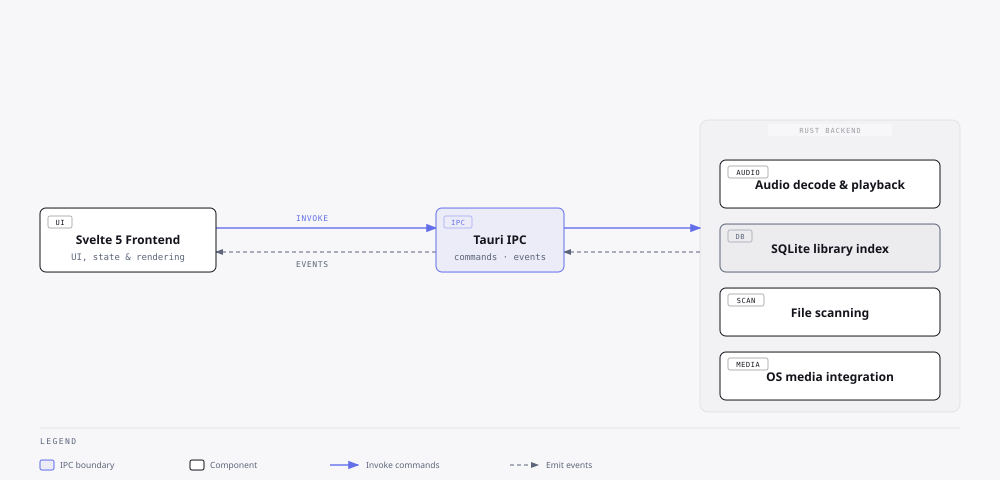

<p align="center">
  
</p>

<h1 align="center">Luminous</h1>
<p align="center">A high-performance home for the music you already own.</p>
<p align="center">
  <a href="https://esoltys.dev/luminous/"><strong>Luminous Homepage</strong></a>
</p>

<p align="center">

[](https://www.rust-lang.org)
[](https://tauri.app)
[](https://www.typescriptlang.org)
[](https://svelte.dev)

</p>

Luminous is a fast, local-first player for your own audio library. Built for anyone who wants the convenience of a modern streaming app without giving up ownership of their music. Turn a folder of files into a library you'll enjoy browsing and listening to.

**[Issues](https://github.com/esoltys/luminous/issues)** - file a bug report or a feature request

**[Luminous Discussion](https://www.reddit.com/r/LuminousMusicPlayer/)** - announcements, general discussion, Q&A, Show and Tell

Luminous doesn't accept PRs as this is a hobby project that I enjoy working on in my spare time.

## Quick Install

[](https://apps.microsoft.com/detail/9PNQ2NFSQ7XW?launch=true&mode=full)

| Platform    | Download |
| ----------- | -------- |
| **Windows** | [Microsoft Store](https://apps.microsoft.com/detail/9PNQ2NFSQ7XW) (recommended — installs and updates automatically)<br>[.exe / .msix](https://github.com/esoltys/luminous/releases/latest) (manual/sideloaded install)<br>[Portable .zip](https://github.com/esoltys/luminous/releases/latest) (no install; keeps your library and settings in a `data` folder beside the app) |
| **Linux**   | [.deb / .rpm / Flatpak](https://github.com/esoltys/luminous/releases/latest) for your distro<br>[AppImage](https://github.com/esoltys/luminous/releases/latest) (runs on any distro; add an empty `portable` file beside it for portable mode) |

## New in 3.0 Release

- **Ten UI locales**: English (CA/US/UK), French (CA/FR), Spanish, German, Italian, Russian and Ukrainian
- **Cosmetic add-on themes**, including the free Mothman theme on the Microsoft Store
- **Large-library performance**: faster scanning and WebDAV sync on network drives, with remote-deletion detection
- **Parametric EQ editor**: free-frequency bands, drag-to-edit response graph, user presets and AutoEq headphone profile import
- **Auto Continue**, richer lyrics (word-by-word sync, `.srt`/`.vtt` sidecars, timing offset) and Love plus 5-star ratings with ListenBrainz/MusicBrainz sync
- **Portable mode** and a portable ZIP release for Windows
- **AppImage** release for Linux

## Architecture

"Isn't this just a web wrapper?" Not in the Electron sense. Tauri renders the UI in the OS's own webview (WebView2 on Windows, WebKit on Linux/macOS) instead of bundling a full Chromium, so there's no shipped browser engine inflating the binary or idling in RAM. And the UI is the only part that's web tech — audio decoding/output, DSP, the library scanner, and the SQLite index all run as native Rust off the UI thread, driving the frontend through events rather than the other way around. See below for how the two sides split.

Luminous splits cleanly along the Tauri boundary: a Svelte 5 frontend handles UI, state, and rendering, while a Rust backend owns everything performance- or system-sensitive — audio decoding and playback, the SQLite-backed library index, file scanning, and OS media integration. Beneath the Tauri IPC layer, pure engine logic is partitioned into dedicated workspace crates under `crates/`: DSP, cryptographic verification, file/tag parsing, and remote wire protocols run with zero dependencies on `tauri` or `rusqlite`. The application crate in `src-tauri` acts as the coordinator, managing SQLite caching, database transactions, background worker loops, and event emission. Keeping decoding, DSP, and disk I/O in Rust off the UI thread is what lets a multi-thousand-track library scan, gapless-playback, and real-time visualizers stay smooth at once.

The IPC commands are deliberately *deep*: each one owns a whole workflow rather than forwarding a single field. The backend owns the built-in Queue (bootstrapped at startup, exposed via an `is_queue` flag — the frontend never infers it from a name), applies equalizer changes as one whole-config call, and keeps every dynamic playlist — genre/decade/BPM auto playlists and user smart playlists alike — *always complete*: whenever the library or a song's stats change, a backend reconciler immediately appends newly-matching songs and evicts stale ones, syncing the live play order without ever reshuffling it. There is no refill logic, and no such setting, anywhere in the frontend.



```
luminous/
├── crates/                   # Engine crates with no Tauri/SQLite dependency
│   ├── luminous-addons/      # Add-on runtime: Ed25519 bundle verification, ChaCha20 decryption, Store entitlement, key cache, memory URI scheme
│   ├── luminous-analysis/    # Audio analysis DSP: EBU R128 loudness metering, true-peak calculation, RMS waveforms, 3-band FFT waveform extraction
│   ├── luminous-audio/       # Playback engine: Symphonia decode, CPAL output, gapless/crossfade, gain chain, spectrum
│   ├── luminous-equalizer/   # Biquad DSP: 10-band graphic & up-to-20-band parametric filters, Equalizer APO parser
│   ├── luminous-metadata/    # Audio & playlist metadata: Lofty tag read/write, CUE sheets, DR meter logs, M3U/PLS/XSPF parsers
│   └── luminous-remote/      # Wire-protocol clients: Subsonic, WebDAV, ListenBrainz, CritiqueBrainz, Lyrics, MusicBrainz OAuth
├── features/                 # BDD Gherkin Feature Specifications
├── src/                      # Svelte 5 + TypeScript Frontend
│   ├── lib/
│   │   ├── components/       # PlayerBar, Visualizers, Equalizer, LyricsView, TagEditor, etc.
│   │   ├── locales/          # UI translations (English CA/US/UK, French CA/FR, Spanish, German, Italian, Russian, Ukrainian)
│   │   ├── stores/           # Global stores (player, collection, navigation, windowLayout, playlists, theme, i18n, prefs)
│   │   ├── types/            # Frontend interfaces
│   │   └── utils/            # Shared utilities (color parsing, filter parsing, lyrics, stats, etc.)
│   └── routes/               # Layouts and navigation views
└── src-tauri/                # Tauri + Rust Backend Application Core
    ├── src/
    │   ├── audio.rs          # Playback adapter: Song -> Track translation, pipeline info
    │   ├── band_waveform.rs  # Layered 3-band waveform SQLite persistence and cache lookup
    │   ├── collection.rs     # Library scanner & folder watcher (query/reconcile/watcher split into collection/)
    │   ├── covermanager.rs   # Cover art extractor and iTunes search API fallback
    │   ├── db.rs             # SQLite schema migration & connection pool (r2d2)
    │   ├── eq_store.rs       # Equalizer presets and persistence
    │   ├── filter_parser.rs  # Search filter syntax parser (artist:, album:, year:, etc.)
    │   ├── install_format.rs # Distro/package format detection for the updater
    │   ├── lib.rs            # Application entry point, background loops, & IPC registry
    │   ├── loudness.rs       # Background R128 loudness analysis worker & SQLite persistence
    │   ├── lyrics.rs         # Lyrics sidecar discovery, embedded extraction & online lookup adapter
    │   ├── main.rs           # Binary entry point invoking luminous_lib::run()
    │   ├── media_session/    # OS media transport integration (SMTC, MPRIS2, Now Playing)
    │   ├── models.rs         # Shared structs and types
    │   ├── musicbrainz.rs    # MusicBrainz OAuth flow & artist events coordinator
    │   ├── organizer.rs      # Tag-based file/folder reorganizer
    │   ├── player.rs         # Playback controller (Shuffle, Repeat, Next/Prev)
    │   ├── playlist.rs       # Playlist manager & Queue abstraction (auto-sync/dynamic/import-export/undo split into playlist/)
    │   ├── ratings_sync.rs   # Two-way rating/Love sync coordinator with ListenBrainz & CritiqueBrainz
    │   ├── scrobbler.rs      # Scrobble offline queue & background submission coordinator
    │   ├── stats.rs          # Play counts, ratings, and history tracking
    │   ├── subsonic/         # Subsonic/Navidrome media-server sync & SQLite caching
    │   ├── tags.rs           # Genre/tag browsing over the existing songs.genre column
    │   ├── tray.rs           # System tray icon, menu, and minimize-to-tray behavior
    │   ├── waveform.rs       # Waveform SQLite persistence and background analysis worker
    │   ├── webdav/           # WebDAV library sync, tag probing & credential management
    │   └── commands/         # Tauri IPC command handlers
    └── Cargo.toml            # App crate dependencies (tauri, rusqlite, r2d2, reqwest, tokio, and engine crates)
```

---

## Building Luminous

Luminous is a cross-platform application that can be built and run on both Linux and Windows.

### Linux (Ubuntu/Debian, Arch/CachyOS)

#### 1. Install System Dependencies
Ensure the required build tools, GTK, WebKit, ALSA, and SSL development headers are installed:

*   **Ubuntu/Debian**:
    ```bash
    sudo apt update
    sudo apt install -y build-essential curl wget file libssl-dev libgtk-3-dev libwebkit2gtk-4.1-dev libsoup-3.0-dev libayatana-appindicator3-dev librsvg2-dev libasound2-dev pkg-config cmake
    ```
*   **Arch/CachyOS**:
    ```bash
    sudo pacman -S --needed base-devel curl wget file openssl gtk3 webkit2gtk-4.1 libappindicator-gtk3 librsvg pkg-config alsa-lib cmake
    ```

#### 2. Install Bun & Rust
*   **Bun**: Install the JavaScript runtime & package manager:
    ```bash
    curl -fsSL https://bun.sh/install | bash
    ```
*   **Rust**: Install the Rust toolchain:
    ```bash
    curl --proto '=https' --tlsv1.2 -sSf https://sh.rustup.rs | sh
    ```

#### 3. Run Development Server

```bash
bun install
bun run install:git-hooks # sets core.hooksPath to use the repository's tracked .githooks/pre-commit hook
bun run tauri dev
```
#### 4. Build Production Bundle
Production bundles include updater artifacts, which must be signed. If you haven't generated a signing keypair yet, see [Generating an Updater Signing Key](#generating-an-updater-signing-key) below first.
```bash
bun run tauri build
```
This produces `.deb`/`.rpm`/AppImage on Linux.

---

### Windows

#### 1. Install Microsoft C++ Build Tools
Download and install the [Visual Studio Installer](https://visualstudio.microsoft.com/visual-cpp-build-tools/). Select the **Desktop development with C++** workload and ensure the MSVC C++ build tools are checked.

#### 2. Install Bun & Rust
Install the JavaScript runtime, package manager, and Rust toolchain

```powershell
winget install Oven-sh.Bun Rustlang.Rustup
```

#### 3. Run Development Server
Run the following commands in your terminal (e.g., PowerShell or Command Prompt):
```powershell
bun install
bun run tauri dev
```

#### 4. Build Production Bundle
Production bundles include updater artifacts, which must be signed. If you haven't generated a signing keypair yet, see [Generating an Updater Signing Key](#generating-an-updater-signing-key) below first.
```powershell
bun run tauri build
```

---

### Generating an Updater Signing Key

Luminous's `tauri.conf.json` has `bundle.createUpdaterArtifacts` set to `true`, so `bun run tauri build` signs every bundle it produces. Without a signing key in the environment, the build fails. Official releases are signed with a repository secret (see [`.github/workflows/release.yml`](.github/workflows/release.yml)), but for local builds you need your own keypair:

1. Generate a keypair (you'll be prompted to set a password, or pass `--ci` to skip it):
    ```bash
    bunx tauri signer generate -w ~/.tauri/luminous.key
    ```
    This writes the private key to `~/.tauri/luminous.key` and prints the corresponding public key.
2. Set the private key and its password as environment variables before building:
    ```bash
    export TAURI_SIGNING_PRIVATE_KEY="$(cat ~/.tauri/luminous.key)"
    export TAURI_SIGNING_PRIVATE_KEY_PASSWORD="your-password"
    ```
    On Windows (PowerShell):
    ```powershell
    $env:TAURI_SIGNING_PRIVATE_KEY = Get-Content -Raw "$HOME\.tauri\luminous.key"
    $env:TAURI_SIGNING_PRIVATE_KEY_PASSWORD = "your-password"
    ```
3. Run `bun run tauri build` as usual. Your own key won't match the `updater.pubkey` baked into `tauri.conf.json`, so a locally-built app can't verify updates signed by the official release key (and vice versa) — that's expected for local builds and only matters if you're testing the updater flow itself.

---

## Testing and Specifications

Luminous uses automated tests at both the frontend (Svelte 5) and backend (Rust) layers.

### Frontend Unit & Integration Tests (Vitest)

Frontend tests are written with Vitest and test component rendering, Svelte 5 stores, and state updates with mocked Tauri APIs.

To run the frontend test suite:
```bash
bun run test:run
```

### Backend Unit & Integration Tests (Rust)

To run the standard cargo unit test suite:
```bash
cd src-tauri
cargo test
```
This also runs the Gherkin feature specs under [`features/`](features) — each `.feature` file has a matching test in `src-tauri/tests/`, so no separate command is needed to exercise them.
