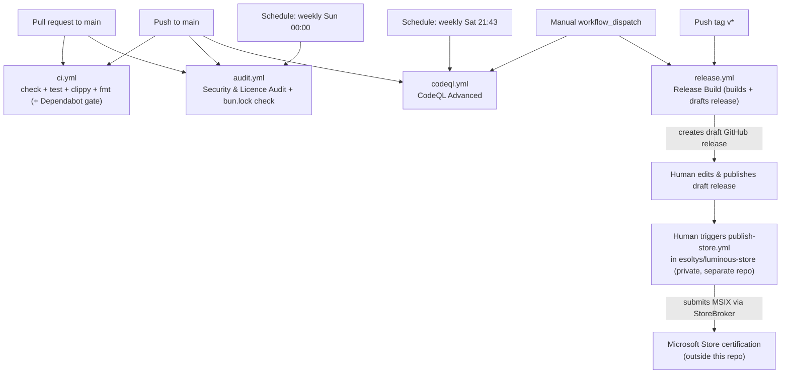

# CI/CD Pipeline

This documents the actual GitHub Actions pipeline as it exists in `.github/workflows/`.
There are four workflow files: `ci.yml`, `audit.yml`, `codeql.yml`, and `release.yml`.
`ci.yml` runs `bun run check` (svelte-check), `bun run test:run` (Vitest), `cargo test`,
`cargo clippy --all-targets -- -D warnings`, and `cargo fmt --check` on every PR — see below. The full local
pre-release re-run of these plus a manual QA pass still lives in
[`docs/RELEASE_CHECKLIST.md`](./RELEASE_CHECKLIST.md) as a belt-and-suspenders step before
cutting a release, not because CI skips them.

Microsoft Store submission is **not** part of this repo's pipeline — it lives in the
separate private repo `esoltys/luminous-store`, triggered manually against a published
`luminous` release tag. See that repo's `README.md` for details.

## What runs on pull requests (and pushes to `main`)

On `pull_request` events, each job in `ci.yml`, `audit.yml`, and `codeql.yml` first runs
`scripts/ci-should-run.sh <frontend|backend|lean|actions>` to check whether the PR modified
any files relevant to that scope (#1824). When a scope is untouched (e.g. a frontend-only PR
for `backend`, or a non-Lean PR for `lean`), the heavy steps in that job are skipped and the
job finishes with `success` in seconds. On `push` to `main`, `schedule`, or `workflow_dispatch`,
`scripts/ci-should-run.sh` always returns `true` so every check runs unconditionally.

- **`ci.yml` — CI**
  - `frontend_check` job (`frontend` + `backend` scopes, since `lint:ast` covers both TS/Svelte and Rust AST rules): `bun run check` (svelte-check + TypeScript, `--fail-on-warnings`),
    `knip` (unused code/dependency detection), and `bun run lint:ast` (ast-grep invariants).
  - `frontend_test` job (`frontend` scope): `bun run test:run` (Vitest) plus script tests.
  - `backend_test` job (`backend` scope; uses `lld`, `line-tables-only` debuginfo, and `Swatinem/rust-cache` with `cache-all-crates: true`):
    - **Architectural Dependency Boundary Checks** (`cargo tree -p <crate> -e normal`): enforces that engine crates in `crates/` never import forbidden application or system dependencies (#1553, #1762):
      - `luminous-audio`: no `tauri`, `rusqlite`, `reqwest`, or `tokio` (must never block or touch UI/DB state on playback paths).
      - `luminous-addons`: no `tauri` or `rusqlite` (security boundary: crypto and package verification cannot manipulate app state).
      - `luminous-analysis`: no `tauri`, `rusqlite`, `reqwest`, or `tokio` (offline DSP analysis cannot reach app state or network).
      - `luminous-equalizer`: no `tauri`, `rusqlite`, `reqwest`, or `tokio` (biquad DSP filters and APO parser cannot reach app state or network).
      - `luminous-metadata`: no `tauri`, `rusqlite`, `reqwest`, or `tokio` (local tag and sidecar parsing cannot reach app state or network).
      - `luminous-remote`: no `tauri` or `rusqlite` (wire-protocol clients cannot access SQLite or Tauri events directly).
      - `luminous-devices`: no `tauri`, `rusqlite`, or `reqwest` (device detection and profiles cannot reach app state or network).
      - `luminous-transcode`: no `tauri`, `rusqlite`, or `reqwest` (converting files for devices cannot reach app state or network). `tokio` is allowed because `luminous-devices` brings it in on Linux.
    - `cargo test --workspace --lib --tests`: runs unit and integration/BDD tests across all workspace crates and `src-tauri`.
    - `cargo clippy --workspace --all-targets -- -D warnings`: fails on any clippy warning across the workspace.
  - `rust_fmt` job (`backend` scope): `cargo fmt --all --check`. The pre-commit hook is opt-in
    per clone, so this is what stops formatting drift reaching `main`. No build needed.
  - `lean_proofs` job (`lean` scope): builds and verifies the machine-checked Lean 4 proofs in
    `verification/lean/` with `lake build --wfail`.
  - `dependabot_regression_gate` job (Dependabot PRs only, `if: github.actor ==
    'dependabot[bot]'`): a real production build (`bun run build`), the Vitest suite
    against it, and `cargo test --workspace --lib --tests --locked` to catch a version bump that left `Cargo.lock`
    inconsistent — regressions `frontend_test`/`backend_test` don't reproduce on their own.
    Clippy isn't duplicated here since `backend_test` already covers every PR, Dependabot's
    included.

`audit.yml` also triggers on `pull_request` and `push` targeting `main`,
plus a weekly `schedule`:

- **`audit.yml` — Security & Licence Audit**
  - `security_audit` job (`backend` scope): runs `EmbarkStudios/cargo-deny-action` (`cargo deny check`) against
    `deny.toml` at the repository root. This validates four distinct checks across all workspace
    crates in `Cargo.lock`:
    - **Licences**: enforces that every crate uses an explicitly allowlisted permissive licence
      (MIT, Apache-2.0, BSD, ISC, Zlib, MPL-2.0, etc.). Any copyleft licence (GPL, AGPL, or
      LGPL-only) fails CI to prevent shipping incompatible obligations in the MIT-licensed app
      and Microsoft Store distribution.
    - **Advisories**: scans the RustSec Advisory Database for known security vulnerabilities
      and yanked crates. Informational unmaintained/unsound transitive dependencies that we
      cannot update directly are explicitly suppressed in `deny.toml` under `[advisories].ignore`
      with documented reasons.
    - **Sources**: denies crates from unknown git repositories or non-crates.io registries.
    - **Bans**: warns on duplicate crate versions (`multiple-versions = "warn"`).
  - `lockfile_check` job (`frontend` scope): runs `bun install --frozen-lockfile` to fail if `bun.lock` has
    drifted from `package.json` (i.e. someone changed a dependency range without
    regenerating the lockfile), and runs `scripts/check-tauri-versions.ts` to ensure
    `@tauri-apps/*` npm packages and matching Rust crates in `Cargo.lock` have not drifted (#1208).

### CodeQL static analysis

- **`codeql.yml` — CodeQL Advanced**
  - Triggers on `push` to `main`, weekly `schedule` (Saturday 21:43 UTC), and manual `workflow_dispatch`.
    It is decoupled from `pull_request` events so PR merges are not blocked by 15–26 minute CodeQL
    runs (#1824). Full CodeQL analysis runs continuously on every merge to `main` and on the weekly schedule.
  - Runs GitHub's CodeQL static analysis across three language matrix legs: `actions`,
    `javascript-typescript`, and `rust` — all using `build-mode: none` (CodeQL's standalone AST
    extractor). Dead apt installations (`libwebkit2gtk-4.1-dev`) and pre-build cargo steps are omitted,
    and build outputs/third-party trees are excluded via recursive `paths-ignore` (`target/**`, `node_modules/**`).
  - Findings are uploaded to the repo's Security tab (`security-events: write`).

### Handling a failing cargo-deny check

Run the check locally with `cargo deny check` (or `bun run audit:cargo`).

1. **Licence rejection (`rejected: license is not explicitly allowed`)**:
   - Inspect the failing crate and its licence expression in `Cargo.lock` / crates.io.
   - If the crate uses a permissive licence (or a multi-licence expression where at least one choice is permissive) compatible with MIT, add the canonical SPDX identifier to `allow` under `[licenses]` in `deny.toml`.
   - If the crate is copyleft (GPL, AGPL, or LGPL-only), **do not allow it**. Revert the dependency bump or find an alternative crate with a permissive licence.
2. **Advisory failure (`advisories FAILED`)**:
   - For an actionable vulnerability in a direct or indirect dependency, update the crate (`cargo update -p <crate>`) to pull the patched release.
   - For an informational unmaintained/unsound advisory in an upstream transitive dependency where no fix or alternative currently exists (e.g. Tauri's Linux webview stack bindings), add an entry to `[advisories].ignore` in `deny.toml` documenting the advisory ID and reason (`{ id = "RUSTSEC-...", reason = "..." }`).

## What runs on merge to `main`

Merging a PR to `main` is itself just a `push` to `main`, so it re-triggers `audit.yml`
and `codeql.yml` exactly as above. Nothing else fires automatically on merge — the actual
release build only happens when a `v*` tag is pushed (see below), which per
`RELEASE_CHECKLIST.md` is a separate, deliberate, manual step after the version-bump PR
merges.

## The release pipeline

### 1. `release.yml` — Release Build

Triggers: `push` of a tag matching `v*`, or manual `workflow_dispatch`. (An earlier
version of this workflow also listened for `release: published`, but neither job's `if:`
guard ever matched that event — it just produced a confusing no-op run every time a
release was published, so the trigger was removed.)

- **`create-release` job** (Linux only): determines the tag (from the ref, or from
  `package.json` version for manual dispatch), then creates a **draft** GitHub release for
  that tag via `gh release create ... --draft` (or reuses one if it already exists). This
  runs once, up front, so the matrix build below doesn't race to create duplicate drafts.
- **`release` job** (matrix: `ubuntu-22.04`, `windows-latest`), depends on `create-release`:
  - The Linux leg stays on the oldest Ubuntu we support, since
    the AppImage/`.deb`/`.rpm` need the build host's glibc (#1700); after the build,
    `scripts/check-glibc-floor.sh` fails it if the AppImage needs glibc newer than 2.35.
  - Installs deps with `bun install`, plus Linux system deps (webkit2gtk, ALSA, OpenSSL,
    appindicator, librsvg, zsync) on the Ubuntu leg.
  - Builds the AppImage with embedded update information (`LDAI_UPDATE_INFORMATION` set to
    `gh-releases-zsync|esoltys|luminous|latest|Luminous.Music.Player_*_amd64.AppImage.zsync`) so
    tools like AppImageUpdate and Gear Lever can perform delta downloads (#1703).
  - Runs `scripts/fix-appimage-zsync.ts` to generate the `.zsync` control file with `zsyncmake` from
    the final AppImage, under the dotted filename GitHub Releases assigns on upload, and checks its
    `SHA-1:`/`Length:` against the AppImage; then uploads it to the release assets via
    `softprops/action-gh-release` (preserving `draft` state). The `.zsync` appimagetool makes during the
    build can't be used: zsyncmake writes it to appimagetool's working directory (`src-tauri/` under
    tauri-action), named with spaces (#1834).
  - Runs `tauri-apps/tauri-action@v0` (wrapped in `Wandalen/wretry.action@v3` for retry
    on transient failures) to build and sign the app, uploading artifacts into the draft
    release created above (`releaseDraft: true`).
  - On the Windows leg only: builds an MSIX package (`bun run tauri:windows:build`) and
    uploads it to the release assets via `softprops/action-gh-release@v2` (again with
    `draft: true` — the action would otherwise publish the release outright).

At the end of this workflow, the GitHub release exists as a **draft** with Linux + Windows
bundles (and MSIX and `.zsync`) attached. It is not visible to end users yet.

Manual re-runs of an existing release: `-f flatpak_only=true` rebuilds only the Flatpak, and
`-f linux_only=true -f tag=vX.Y.Z` rebuilds only the AppImage/`.zsync`/`.deb`/`.rpm` from that tag and
replaces them and their `latest.json` entries, leaving the Windows assets and Flatpak alone.
Test the build first with `-f dry_run=true`, which attaches the Linux installers to the run as
an artifact and touches no release:

```bash
gh workflow run release.yml -f dry_run=true -f tag=vX.Y.Z
```

```bash
gh workflow run release.yml -f linux_only=true -f tag=vX.Y.Z
```

### 2. Manual: publishing the draft release

Per `RELEASE_CHECKLIST.md`, a human edits the draft release body (replacing the
auto-generated notes with `docs/release-notes/vX.Y.Z.md`) and clicks **Publish**. This is a manual GitHub UI action —
no workflow does it automatically.

### 3. Manual (separate repo): Microsoft Store submission

Once the release is published, Store submission is triggered by hand in
`esoltys/luminous-store` (private):

```bash
gh workflow run publish-store.yml -f tag=vX.Y.Z
```

That repo's `publish-store.yml` downloads the tag's `.msix`/`.msixbundle` asset from this
repo via `gh release download`, then runs Microsoft's StoreBroker PowerShell module to
submit it. See `esoltys/luminous-store`'s `README.md` for the full flow, including the
`-f update_screenshots=true` option for also replacing the live listing text/screenshots.
This repo (`luminous`) has no visibility into or dependency on that submission — it's
entirely decoupled, matching the previous in-repo `publish-store.yml`'s design (re-runnable
independently, doesn't gate or get gated by the build).

## Trigger graph



One thing worth calling out explicitly since it's easy to miss:

- Microsoft Store submission lives entirely in `esoltys/luminous-store`, not this repo. It's
  triggered by hand after a release is published, decoupled from `release.yml`, and can be
  re-run independently without touching this repo at all.

## Add-on themes

Optional add-on themes (epic #1036) are mostly outside this repo's pipeline:

- Building, signing, encrypting and publishing add-on bundles happens in the private
  `esoltys/luminous-store` repo, through its own manual `publish-addin.yml` workflow, and the
  key-release Worker is deployed from there too. Nothing in `luminous` triggers or waits on
  any of it, and `release.yml` never touches add-on bundles.
- The app's own add-on code (overlay runtime, Store entitlement, key cache, Settings section)
  is ordinary app code, so the normal `ci.yml` jobs above cover it: Vitest, `cargo test`,
  clippy and `cargo fmt --check`.
- CI cannot exercise the real purchase and key-release path. Dev builds have no package
  identity, so the Store is unavailable to them, and the path only runs in a packaged build
  installed from the Store. That is tested by hand on a package flight (see
  [`docs/PERMISSIONS.md`](./PERMISSIONS.md)).
